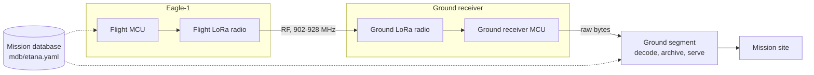

# Etana

[](https://github.com/Ogmar/etana/actions/workflows/ci.yml)

High-altitude balloon mission comprising flight software, a CCSDS telemetry
ground segment, and a mission site.

The vehicle, Eagle-1, carries an atmospheric payload (ozone, CO₂) with GPS and
housekeeping instrumentation to approximately 30 km, downlinking telemetry as
CCSDS Space Packets over a LoRa link: a flight MCU encodes and transmits over an
onboard LoRa radio, a ground receiver (a matching LoRa radio paired with its own
bridging MCU) picks it up and forwards the raw bytes to the ground segment. The
ground segment decodes, archives, and displays the telemetry in real time.

> **Status.** Ground segment Phases 0-3 complete: a CCSDS codec, a transport
> seam, a simulator that flies a realistic profile with injected link loss, an
> ingestion pipeline that archives telemetry to Postgres with per-APID loss
> detection and replay/recalibration, a read-only REST API, and a live dashboard
> — deployed to production (see below). Flight software and the mission site are
> planned. This README describes the target system.

**Dashboard:** the ground segment is live — API on Railway, dashboard on Vercel.
**[Open the dashboard](https://etana-eagle.vercel.app/)**
· [source](ground-segment/frontend/)

**Flight profile explorer:** an interactive tool to explore how burst altitude,
ascent rate, descent, and wind shape the mission — runs the real flight model, no
install required. **[Open the explorer](https://etana-flight-explorer.streamlit.app/)**
· [source](tools/flight-explorer/)

## Architecture



The mission database (`mdb/etana.yaml`) is the sole definition of packet
structure. The flight MCU reads it to encode telemetry; the ground segment reads
it to decode telemetry. The ground receiver — a LoRa radio paired with a
bridging MCU — carries CCSDS bytes between the two without interpreting them; it
is a transparent relay, not a decoder.

The ground segment abstracts the transport behind a packet-source interface,
making the receive path independent of the source of bytes. During development
that source is a simulator standing in for the flight MCU and flight LoRa radio,
emitting the same byte stream over TCP that the ground receiver MCU will deliver
in flight — which allows the ground segment to be built and tested before flight
hardware exists.

See [`docs/SPECIFICATION.md`](docs/SPECIFICATION.md) and
[`docs/DESIGN.md`](docs/DESIGN.md) for detail.

## Layout

```
etana/
├── mdb/etana.yaml        # mission database — packet definitions
├── ground-segment/       # telemetry receive, decode, archive, dashboard
├── flight-software/      # embedded flight software (planned)
├── tools/                # team utilities (e.g. the flight profile explorer)
├── website/              # mission site (planned)
└── docs/                 # specification and design
```

## Getting started

Run instructions will be added with the ground-segment services and
`docker-compose.yml` (Phase 3). See [`docs/SPECIFICATION.md`](docs/SPECIFICATION.md)
and [`ground-segment/README.md`](ground-segment/README.md).

## Development

The ground segment is developed as installable Python packages under
`ground-segment/`. To run the full simulator-to-ingestion demo:

```
cd ground-segment
pip install -e packages/ccsds
pip install -e services/simulator
pip install -e services/ingestion
python run_demo.py --speed 60
```

This streams a full simulated flight through the ingestion runner. See
[`ground-segment/README.md`](ground-segment/README.md) for details and for
running the two sides separately.

Continuous integration runs each package's test suite on every push and pull
request to `main`, across Python 3.10–3.12 (`.github/workflows/ci.yml`). The
badge above reflects the current state of `main`. To run the tests locally:

```
cd ground-segment/packages/ccsds   && pip install -e ".[dev]" && pytest
cd ground-segment/services/ingestion && pip install -e ".[dev]" && pytest
cd ground-segment/services/simulator && pip install -e ".[dev]" && pytest
```

## License

Released under the MIT License. See [`LICENSE`](LICENSE).
